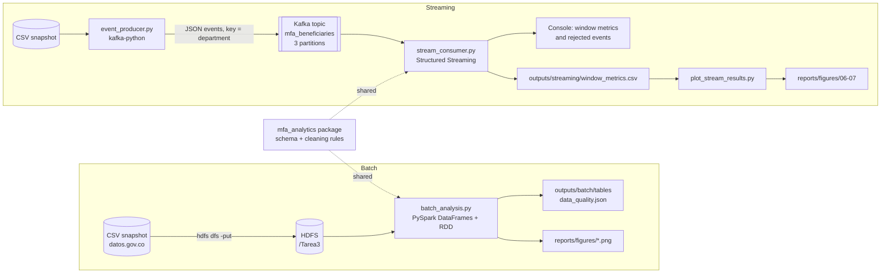

# Más Familias en Acción: Batch and Streaming Analytics with Spark and Kafka

Batch and real-time processing of the Colombian **Más Familias en Acción**
beneficiaries dataset (≈4 million rows, 735 MB) with **PySpark**,
**Apache Kafka** and **Spark Structured Streaming**.

> Academic project for the *Big Data* course (UNAD, code 202016911, Task 3).
> The streaming part replays historical records as **simulated** events; it is
> not a live feed of the program.

---

## Contents

1. [Overview](#overview)
2. [Problem statement](#problem-statement)
3. [Dataset](#dataset)
4. [Architecture and data flow](#architecture-and-data-flow)
5. [Technology stack](#technology-stack)
6. [Setup](#setup)
7. [Running the batch analysis](#running-the-batch-analysis)
8. [Running the streaming pipeline](#running-the-streaming-pipeline)
9. [Outputs](#outputs)
10. [Project structure](#project-structure)
11. [Testing and code quality](#testing-and-code-quality)
12. [Design decisions](#design-decisions)
13. [Limitations](#limitations)
14. [References](#references)

---

## Overview

The project has two independent pipelines that share the same data model and
cleaning rules:

| Pipeline | What it does | Entry point |
|---|---|---|
| **Batch** | Loads the full CSV from HDFS, profiles data quality, cleans and types it, runs an exploratory analysis and saves tables and charts. | `jobs/batch_analysis.py` |
| **Streaming** | A Python producer publishes dataset records to a Kafka topic; a Spark Structured Streaming job validates them and computes per-department metrics over 1-minute windows. | `jobs/event_producer.py`, `jobs/stream_consumer.py` |

## Problem statement

*Más Familias en Acción* is a conditional cash-transfer program for vulnerable
families in Colombia. The dataset records, for every group of beneficiaries,
whether they have a bank product ("bancarizado"), which makes it possible to
study financial inclusion across territories and population groups.

**Question:** *Where are the program's beneficiaries concentrated, and in which
departments and population groups is financial inclusion (having a bank
product, "bancarizado") lowest?*

Supporting questions: how beneficiaries are distributed by population type, age
range and gender, how many remain active, and how enrollment evolved over time.

## Dataset

* **Source:** [Beneficiarios Más Familias en Acción](https://www.datos.gov.co/Inclusi-n-Social-y-Reconciliaci-n/Beneficiarios-M-s-Familias-en-Acci-n/xfif-myr2/about_data), datos.gov.co (dataset `xfif-myr2`).
* **Snapshot:** exported 2026-10-23, 3,958,594 rows × 22 columns, 735 MB.
* **Granularity:** each row is a *group* of beneficiaries with identical
  attributes; `CantidadDeBeneficiarios` holds the group size. All metrics are
  therefore weighted by that column.

The full file is not versioned (see [`data/README.md`](data/README.md) for
download instructions and the column dictionary). A 49-row sample of real
records is included in `data/sample/`.

## Architecture and data flow



The data model has three layers, defined in `src/mfa_analytics/schema.py`:

1. **Raw** - the CSV read with an explicit all-string schema (the source mixes
   `ND` tokens, thousands separators and placeholder dates, so type inference
   would be unreliable).
2. **Canonical** - same values, English snake_case column names. It is also the
   payload contract of the Kafka events.
3. **Curated** - typed and normalized columns (`CURATED_SCHEMA`): booleans,
   dates, integer counts and normalized categories.

## Technology stack

Versions of the course virtual machine where the project runs:

| Component | Version | Notes |
|---|---|---|
| OS | Ubuntu Server 22.04.5 LTS | VirtualBox VM |
| Java | OpenJDK 11.0.32 | |
| Python | 3.10.12 | |
| Apache Hadoop (HDFS, YARN) | As installed in the course (Anexo 1) | `fs.defaultFS = hdfs://localhost:9000` |
| Apache Spark | 3.5.8 (Scala 2.12.18) | `/opt/spark` |
| PySpark (pip) | 3.5.1 | Used by the tests |
| Apache Kafka | 3.9.2 (`kafka_2.12-3.9.2`) with ZooKeeper | `/opt/Kafka`, as in Anexo 3 |
| Spark-Kafka connector | `org.apache.spark:spark-sql-kafka-0-10_2.12:3.5.3` | Version prescribed by Anexo 3 |
| kafka-python | latest from PyPI | |
| pandas / matplotlib | see `requirements.txt` | Only for small aggregated results |

> The connector (3.5.3) and Spark (3.5.8) share the 3.5 line and Scala 2.12, so
> they are compatible. If a `NoSuchMethodError` or `ClassNotFoundException`
> ever appears, use the connector matching your Spark version
> (`spark-sql-kafka-0-10_2.12:3.5.8`).

## Setup

All commands run **inside the VM** (user `vboxuser`) from the repository root.

```bash
# 1. Get the code
git clone https://github.com/<your-user>/mas-familias-spark-kafka.git
cd mas-familias-spark-kafka

# 2. Install the package and its dependencies (editable mode, user site-packages)
pip install -e ".[dev]"

# 3. Place the dataset (see data/README.md)
mkdir -p data/raw
mv ~/data/beneficiarios_mfa.csv data/raw/beneficiarios_mfa.csv
```

`pip install -e .` makes the `mfa_analytics` package importable by `python3`
and `spark-submit`. The small `setup.py` shim keeps editable installs working with the
pip 22.0 shipped by Ubuntu 22.04 (all metadata stays in `pyproject.toml`). If you prefer not to install it, export
`PYTHONPATH="$PWD/src"` before running any command.

The VM has 3.8 GB of RAM: stop Hadoop (`stop-all.sh` as `hadoop`) while running
the streaming pipeline, and keep the `--master "local[2]"` settings below.

## Running the batch analysis

1. Start HDFS and upload the file (as the `hadoop` user, once):

   ```bash
   su - hadoop
   start-all.sh
   hdfs dfs -mkdir -p /Tarea3
   hdfs dfs -put /path/to/beneficiarios_mfa.csv /Tarea3/
   exit
   ```

2. Run the job (as `vboxuser`, from the repository root):

   ```bash
   spark-submit --master "local[2]" --driver-memory 1g \
     jobs/batch_analysis.py \
     --input hdfs://localhost:9000/Tarea3/beneficiarios_mfa.csv
   ```

   Other inputs are accepted: `--input file://$PWD/data/raw/beneficiarios_mfa.csv`
   reads the local copy, and running without `--input` uses the bundled sample
   (a quick smoke test that takes a few seconds).

| Option | Default | Description |
|---|---|---|
| `--input` | `data/sample/mfa_sample.csv` | CSV path or URI (`file://`, `hdfs://`) |
| `--output-dir` | `outputs/batch` | Tables and data-quality report |
| `--figures-dir` | `reports/figures` | PNG charts |
| `--shuffle-partitions` | `8` | Spark SQL shuffle partitions |

The job prints the raw and curated schemas, the data-quality report, every
aggregated table and the RDD cross-check result, so its console output can be
used as evidence.

## Running the streaming pipeline

Use three terminals (PuTTY sessions) in the VM.

**Terminal 1 - start ZooKeeper and Kafka (as in Anexo 3) and create the topic**

```bash
sudo /opt/Kafka/bin/zookeeper-server-start.sh /opt/Kafka/config/zookeeper.properties &
sudo /opt/Kafka/bin/kafka-server-start.sh /opt/Kafka/config/server.properties &

/opt/Kafka/bin/kafka-topics.sh --create --if-not-exists \
  --bootstrap-server localhost:9092 \
  --replication-factor 1 --partitions 3 --topic mfa_beneficiaries
/opt/Kafka/bin/kafka-topics.sh --describe --bootstrap-server localhost:9092 --topic mfa_beneficiaries
```

**Terminal 2 - start the Spark consumer first** (it reads new events only)

```bash
spark-submit --master "local[2]" --driver-memory 1g \
  --packages org.apache.spark:spark-sql-kafka-0-10_2.12:3.5.3 \
  jobs/stream_consumer.py --window "1 minute" --trigger "10 seconds"
```

The first run downloads the connector from Maven Central (internet required).

**Terminal 3 - start the producer**

```bash
python3 jobs/event_producer.py \
  --input data/raw/beneficiarios_mfa.csv \
  --rate 5 --max-events 900 --invalid-ratio 0.02
```

What you will see:

* Producer: one log line per event (`#12 [ok] dept=ANTIOQUIA count=1 banked=SI`).
* Consumer: a **Window metrics** table every micro-batch with events,
  beneficiaries and banking rate per department and window, plus a
  **Rejected events** table listing invalid messages and the reason.
* Spark UI at `http://localhost:4040` (jobs, stages, streaming query statistics).
  With VirtualBox NAT, add a port-forwarding rule `4040 → 4040`.

Stop with `Ctrl+C` in terminals 2 and 3 (both shut down cleanly), then plot:

```bash
python3 jobs/plot_stream_results.py
```

| Producer option | Default | Description |
|---|---|---|
| `--input` | `data/sample/mfa_sample.csv` | Source CSV to sample rows from |
| `--rate` | `2` | Events per second |
| `--max-events` | `0` | Stop after N events (`0` = until Ctrl+C) |
| `--invalid-ratio` | `0` | Share of deliberately invalid messages |
| `--seed` | `42` | Makes the event sequence reproducible |
| `--topic`, `--bootstrap-servers` | `mfa_beneficiaries`, `localhost:9092` | Kafka settings |

| Consumer option | Default | Description |
|---|---|---|
| `--window` | `1 minute` | Tumbling window size (event time) |
| `--watermark` | `2 minutes` | Allowed lateness before a window is closed |
| `--trigger` | `10 seconds` | Micro-batch interval |
| `--starting-offsets` | `latest` | Use `earliest` to replay the whole topic |
| `--timeout-seconds` | `0` | Stop automatically after N seconds |
| `--checkpoint-dir` | temporary | Omit it so each demo run starts clean |

## Outputs

| Path | Content | Versioned |
|---|---|---|
| `outputs/batch/data_quality.json` | Row counts, missing values per column, duplicates, placeholders, rejected rows | No |
| `outputs/batch/tables/*.csv` | Aggregated tables (national, department, population type, status, ethnicity, age × gender, enrollment year) | No |
| `reports/figures/01-05_*.png` | Batch charts | Yes |
| `outputs/streaming/window_metrics.csv` | Window metrics of every micro-batch | No |
| `reports/figures/06-07_*.png` | Streaming charts | Yes |

## Project structure

```text
mas-familias-spark-kafka/
├── README.md
├── pyproject.toml              # Package metadata, dependencies, pytest and ruff config
├── requirements.txt            # Same dependencies for a plain `pip install -r`
├── setup.py                    # Shim for editable installs with older pip
├── data/
│   ├── README.md               # Source, download steps and column dictionary
│   ├── raw/                    # Full dataset goes here (git-ignored)
│   └── sample/mfa_sample.csv   # 49 real rows for tests and smoke runs
├── src/mfa_analytics/          # Reusable, tested library code
│   ├── schema.py               # Raw, canonical, curated and event schemas
│   ├── cleaning.py             # Typing and cleaning rules (batch + streaming)
│   ├── quality.py              # Data-quality profiling
│   ├── analysis.py             # Weighted aggregations and RDD cross-check
│   ├── plotting.py             # Matplotlib charts from small aggregates
│   ├── spark_io.py             # SparkSession and I/O helpers
│   ├── config.py               # Default settings
│   └── streaming/
│       ├── events.py           # CSV sampling and event building (pure Python)
│       └── transform.py        # Stream parsing, validation and windowing
├── jobs/                       # Thin command-line entry points
│   ├── batch_analysis.py
│   ├── event_producer.py
│   ├── stream_consumer.py
│   └── plot_stream_results.py
├── tests/                      # pytest suite (runs on the sample, no Kafka needed)
└── reports/figures/            # Charts used in the report
```

## Testing and code quality

```bash
python3 -m pytest          # 11 tests: cleaning rules, batch blocks, events, stream parsing
ruff check . && ruff format --check .
```

The tests use a local SparkSession and the bundled sample. Stream parsing is
tested on a static DataFrame shaped like the Kafka source, so Kafka is not
required to run them.

## Design decisions

* **Explicit schemas, no inference.** The raw CSV is read as strings and typed
  with documented rules; Spark also validates the header (`enforceSchema=false`).
* **One set of rules for batch and streaming.** The consumer reuses
  `clean_beneficiaries`; only Spark SQL functions are used (no Python UDFs), so
  the rules run on the JVM and work on streaming DataFrames.
* **Nothing is dropped silently.** Missing values are labelled `NOT REPORTED`;
  invalid records are separated and counted. Exact duplicate rows are reported
  but kept, because without an identifier they can be different people.
* **Weighted metrics.** Every count sums `beneficiary_count`. The banking rate
  is `banked / (banked + not banked)`; unknown status is reported separately.
* **RDD where it adds value.** One aggregation is also computed with
  `map` + `reduceByKey` and must match the DataFrame result.
* **Spark does the heavy work.** Only aggregated results (tens of rows) reach
  pandas for plotting; `collect()` is never used on the dataset.
* **Kafka keyed by department.** Events of the same department land in the same
  partition (order preserved per department); 3 partitions allow parallel reads.
* **Event time and watermark.** Windows use the event timestamp, and the
  watermark bounds the streaming state.

## Limitations

* **Simulated stream.** Events are real historical records sampled at random
  and sent with the current timestamp; arrival rate and timing are artificial.
  Every event carries `"simulated": true`.
* **No beneficiary identifier.** Duplicates cannot be resolved, and records are
  groups, so person-level analysis is not possible.
* **Sparse attributes.** Ethnicity, education level and benefit type are mostly
  `ND`; results for them describe only the reported subset.
* **Snapshot.** Results describe the export of 2026-10-23. Dates have monthly
  granularity and `1900-01-01` placeholders are treated as missing.
* **Single-node environment.** The project runs on one VM (local mode, one
  Kafka broker, replication factor 1). It demonstrates the design, not
  production-scale performance.

## References

* Datos Abiertos Colombia. *Beneficiarios Más Familias en Acción* (xfif-myr2). https://www.datos.gov.co/Inclusi-n-Social-y-Reconciliaci-n/Beneficiarios-M-s-Familias-en-Acci-n/xfif-myr2/about_data
* Apache Spark. *Structured Streaming + Kafka Integration Guide*. https://spark.apache.org/docs/3.5.1/structured-streaming-kafka-integration.html
* Apache Spark. *Structured Streaming Programming Guide*. https://spark.apache.org/docs/3.5.1/structured-streaming-programming-guide.html
* Apache Kafka. *Documentation 3.9*. https://kafka.apache.org/39/documentation.html
* kafka-python documentation. https://kafka-python.readthedocs.io/
* Macías, M., & Gómez, M. (2015). *Introducción a Apache Spark: para empezar a programar el big data*. Editorial UOC.
